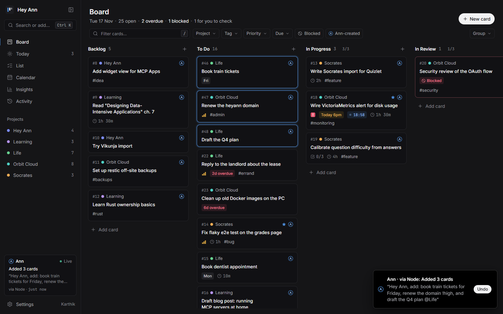
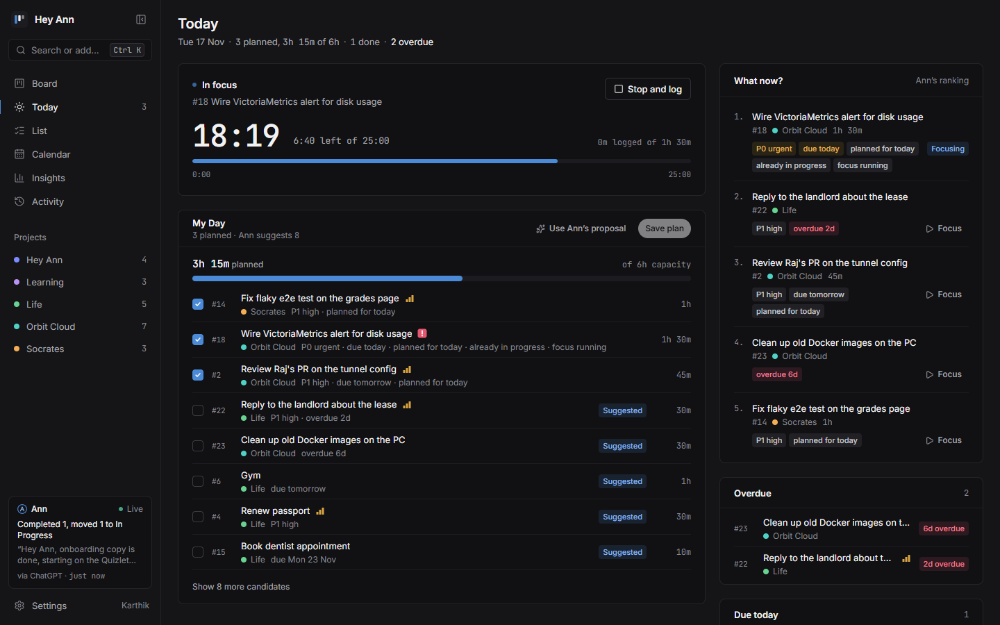
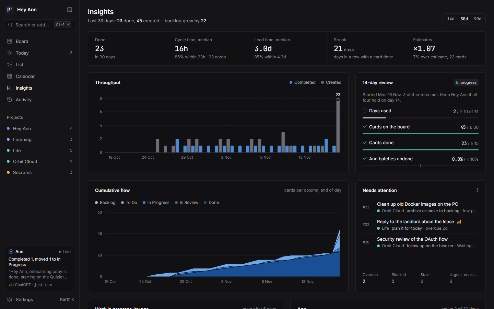
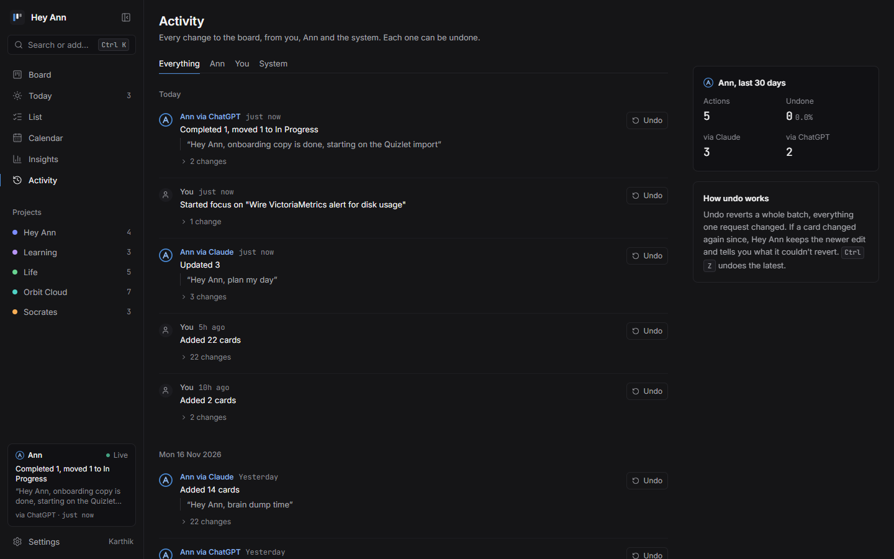
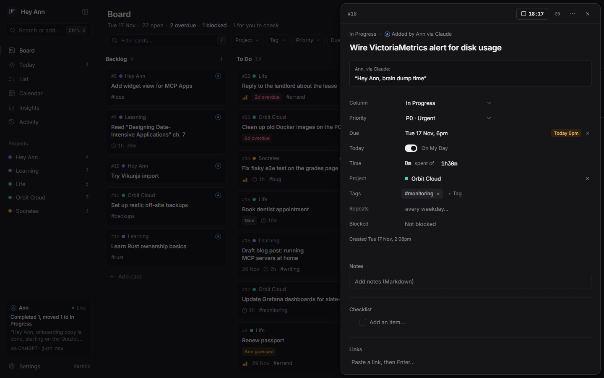
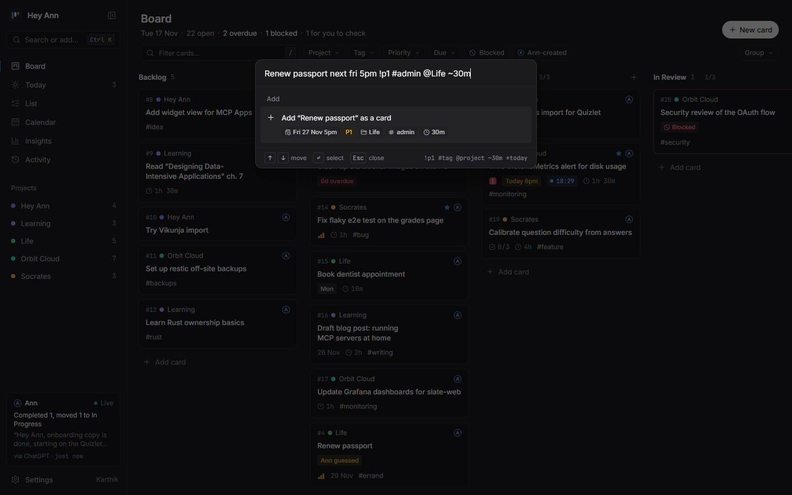
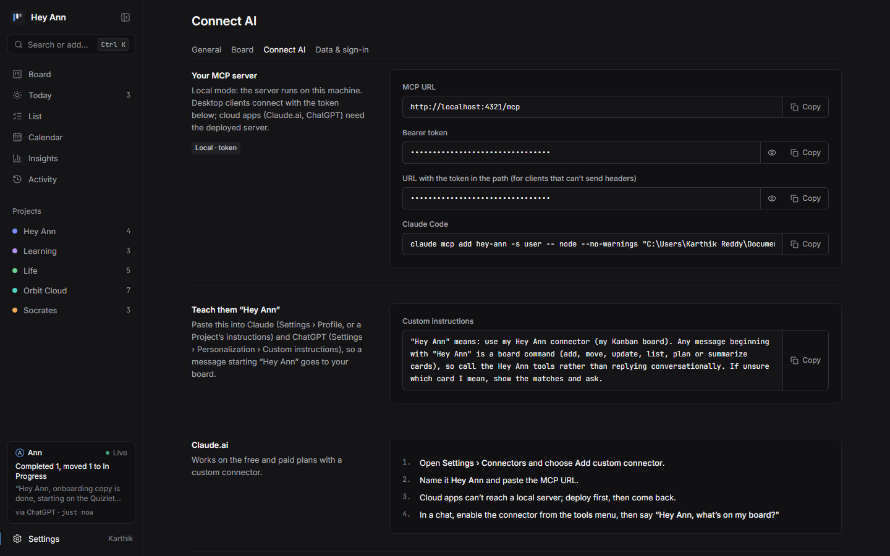

# Hey Ann

A personal Kanban board that Claude and ChatGPT run for you. Start a message with *"Hey Ann, …"* and Ann turns brain dumps into cards, moves work along, plans your day and keeps score. A fast, dark web board shows every change live, with an Undo button.

> "Hey Ann, I need to finish the DB migration by Friday, review Raj's PR, and prep slides for Monday."
>
> **Added 3 cards:** #1 Finish the DB migration · due Fri 20 Nov · #2 Review Raj's PR · #3 Prep slides · due Mon 23 Nov



| Today: focus timer, My Day and Ann's ranking | Insights |
|---|---|
|  |  |
| **Activity: every change, with what you said and an Undo button** | **Card detail** |
|  |  |
| **Command palette with live parsing** | **Connect AI** |
|  |  |

## What it does

**From chat (MCP, 16 tools)**
- **Brain dumps to cards.** Ann adds many cards in one call. Dates like "friday", "tomorrow 5pm" or "eow" are resolved in *your* timezone. Possible duplicates are flagged instead of created, and the sentence you said is stored with each card.
- **Status updates in one sentence.** "Done with X, started Y, Z is blocked on W" becomes one batch. Cards can be named by `#id` or by any part of their title. If a name is ambiguous, Ann changes nothing and asks which card you meant.
- **Planning.** `whats_next` ranks your cards by urgency, priority, today's plan and the time you have. `plan_day` sizes a plan to your daily capacity. `triage` lists overdue, stale and blocked cards.
- **Reporting.** Standup, daily and weekly summaries, plus stats: throughput, cycle time, streak, estimate accuracy, and how much Ann is being used.
- **Undo anything.** Every change is stored as a batch with before and after snapshots, so "Hey Ann, undo" reverts the last action as a whole. Undo can itself be undone. If a card was edited after the batch, undo leaves that edit alone.
- **Focus timer and time tracking, recurring cards** ("every weekday", "monthly"), **checklists, links, projects, tags**, and board configuration (columns, WIP limits).

**In the browser**
- Board with columns Backlog → To Do → In Progress → In Review → Done, drag and drop, WIP limits, and swimlanes.
- Quick add with inline syntax: `Fix login tomorrow 5pm !p1 #auth @backend ~2h *today every weekday`.
- Command palette (Ctrl/Cmd+K), keyboard shortcuts, and global Ctrl/Cmd+Z.
- Views: Today (My Day), List, Calendar, Insights, and Activity, which shows each change with the sentence that caused it.
- Live updates: when Ann changes something from Claude or ChatGPT, the board updates instantly and shows a toast with Undo.
- Settings: Connect AI (URL and instruction snippet), JSON import/export, and backups.

## Run it locally

Requires Node 22.18+ (24 recommended). There are no native modules and no build step for the server.

```bash
npm install
npm run seed      # optional: a realistic board with 3 weeks of history
npm start         # builds the UI on first run; http://localhost:4321
npm run dev       # hot reload: UI on :5173, API on :4321
npm test
```

Locally there's no login, and MCP is available at `http://localhost:4321/mcp`; Settings → Connect AI shows the bearer token. To use it from Claude Code over stdio:

```bash
claude mcp add hey-ann -s user -- node --no-warnings "<repo>/src/mcp/stdio.ts"
```

## Deploy

[docs/DEPLOY.md](docs/DEPLOY.md) runs Hey Ann on a k3s home server:
- The UI is reachable only on your tailnet, behind a password that is remembered per device.
- The MCP endpoint is public, behind Orbit Identity OAuth (owner only, CIMD clients: Claude, ChatGPT, Claude Code).

[docs/SETUP-CLIENTS.md](docs/SETUP-CLIENTS.md) covers connecting Claude and ChatGPT and making "Hey Ann" fire reliably.

## How it's built

```
src/core/     domain: board + batched undoable writes (board.ts), NL dates/recurrence (nlp.ts),
              fuzzy card resolution (resolve.ts), ranking/plans/summaries/insights (insights.ts)
src/mcp/      the MCP tools (server.ts), stdio entry
src/server/   Hono HTTP: API, SSE live events, password sessions, OAuth resource server
web/          React 19 + Vite + Tailwind 4 UI
deploy/       k3s manifests, backup/restore jobs
```

The stack is TypeScript run natively by Node, Hono, the MCP SDK, `node:sqlite` with FTS5, and `jose`.

- **Data:** one SQLite file, with daily integrity-checked backups.
- **Writes:** every write goes through `Board.batch()`, so the web UI, Claude and ChatGPT all share the same history and undo.

Further docs: [docs/PLAN.md](docs/PLAN.md) (the plan and the reasoning behind it) and [docs/API.md](docs/API.md) (the HTTP API).
